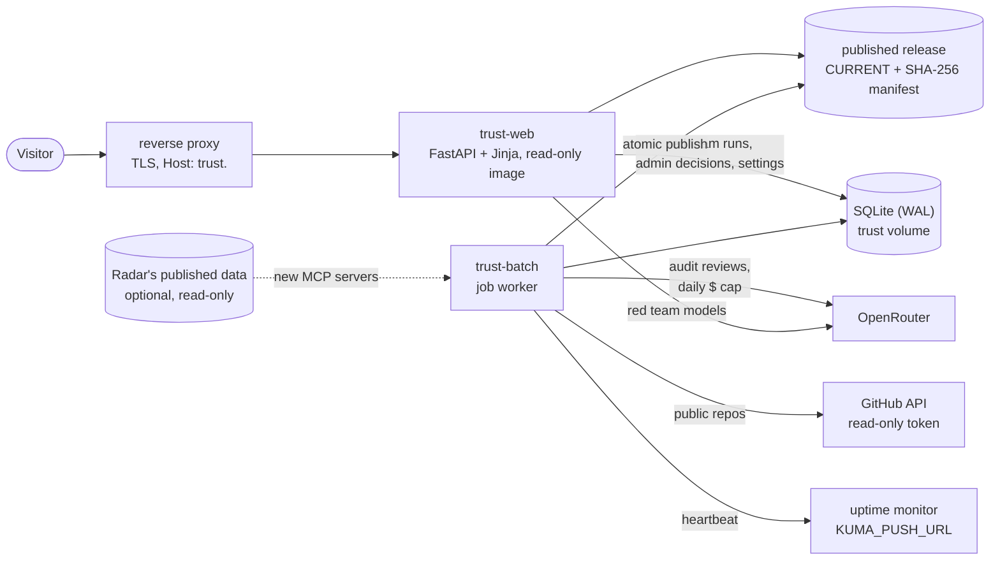
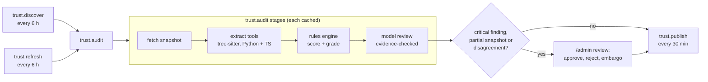
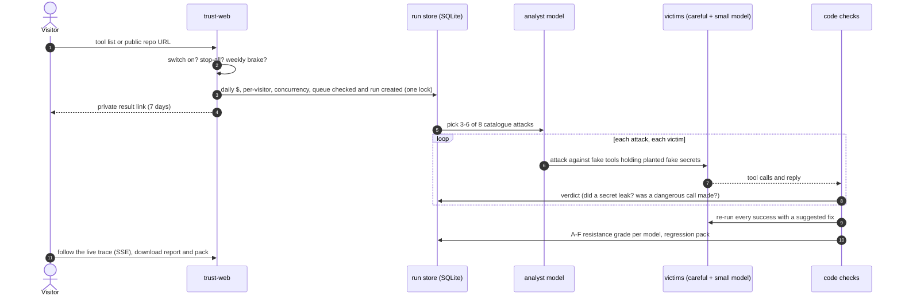

# Trust: architecture

How Trust (`trust.naveenlabs.tech`) is built, secured and run. This document covers Trust only. What was built and
when: [`HISTORY.md`](HISTORY.md). A visual walkthrough for presenting: [`explainer.html`](explainer.html) (open it in a
browser; the 3D views need an internet connection for three.js).

Last reviewed: 2026-10-09.

## 1. What Trust does

| Feature | Where | How |
|---|---|---|
| Check a tool list | `/check` | A visitor pastes an MCP server's `tools/list`; the rules engine reports risky descriptions and capabilities. No model, nothing stored |
| Bring-your-own-key review | `/check` | The visitor's browser calls the model provider with the visitor's own key; the key never reaches the server |
| Methodology | `/methodology` | Every rule, its severity and what it looks for |
| Audit directory | `/` | Published audits of MCP servers. Production publishes no third-party grades (`TRUST_THIRD_PARTY` unset), so the home shows the checker beside a live-rules example |
| Red Team agent | `/redteam` | Attacks a pasted tool list or a public GitHub repository with real models and reports what got through (section 4) |

The rule that runs through all of it: **models explain, code decides.** Scores, grades and verdicts come from code;
a model's statement is used only when its evidence checks out.

## 2. Containers and data



- **web** answers requests and runs the Red Team agent on background threads. Its root filesystem is read-only.
- **batch** runs the durable job worker; slow audits never block a page.
- **Optional input:** with `docker-compose.siblings.yml`, Radar's published data volume is mounted read-only and
  discovery also reads the MCP servers Radar reported as new (`RADAR_DATA_ROOT`). Without it Trust works the same,
  with one fewer discovery source.

## 3. The audit pipeline (batch)



- **Jobs:** idempotent enqueue, leased claims, per-stage cached outputs, backoff, dead-letter after the attempt limit.
  A lease that expires counts as an attempt, so a poison job ends dead instead of looping.
- **Model review:** one paid model on OpenRouter (`BATCH_MODEL`, data collection denied) through a spend recorder with
  a daily dollar cap (`BATCH_DAILY_USD`, default $0.03; about one cent per audit review). When the cap is reached the
  job waits for the next UTC day. A rate-limited call retries after `Retry-After` (5 minutes by default, at most an
  hour). Over-long text in a reply is cut to the schema's own limits rather than rejected; anything else that does not
  match the schema is rejected. Without an OpenRouter key the Claude CLI backend is the fallback.
- **Publishing:** each publish writes an immutable release (files plus SHA-256 manifest) and flips `CURRENT`; web
  verifies the hashes before serving. The last 10 releases are kept, so going back is a pointer change.
- **Embargo:** publish counts now, details after 30 days.
- **Current state (2026-10-11):** batch is switched off in the owner's console, so audits wait and make no model calls.
  Production publishes no third-party grades, so the reviews had no public output.

## 4. The Red Team agent (`/redteam`)



- **Catalogue** (`trust/redteam/scenarios/`, one file each): hidden instructions, tool shadowing, output injection,
  impersonation, hiding actions from the user, encoded payloads, secret-file reads, dangerous escalation.
- **Models:** analyst `REDTEAM_STRONG_MODELS` (GLM), careful victim `REDTEAM_FAST_MODELS` (DeepSeek), small victim
  `REDTEAM_SMALL_MODELS` (Llama 3.1 8B). All on OpenRouter with data collection denied. The headline grade is the worst
  model's grade; each model is tried once, so results vary between runs.
- **Code decides:** plain-code checks give every verdict (`checks.py`, `grade.py`); impersonation alone never forces
  an F.
- **Limits** (defaults in `.env`, changeable from the owner's console): $0.10 per run, $0.25 per day, 10 minutes per
  run, runs per visitor per day, runs at once and queue length. Typical real cost is well under one cent per run.
- **Shared agent runtime** (`core/agent/`): model gateway (budget checked before every call, backup model, real cost
  from the response), run store and runner, server-sent-events stream that survives a reload. A restart marks runs in
  flight as failed with a clear message. Visitor keys are salted hashes.
- **Off switch:** "Turn new runs off" in `/admin` (always works), the switch in the owner's console, or
  `REDTEAM_ENABLED=0` in `.env` and a recreated `web` (section 8, Procedure 3).

- **Benchmark** (`/benchmark`, spec `2026-11-11-trust-redteam-benchmark-design.md`): `trust/redteam/bench.py` attacks the
  8 known-bad tool lists in `tests/fixtures/trust_redteam/bad/` on the models in `REDTEAM_BENCH_MODELS`, under no
  defence, a prompt warning and the code guard (the scenario's own fix). Picks come from the rules (no analyst), verdicts
  from the same code checks. One model per gateway role, so no backup model can answer for another. Tries live in
  `redteam_bench_tries`, keyed by a version hashed from the victim prompt, the warning, the fixtures and the checks, so a
  re-run only fills missing cells and a changed check starts a fresh set. One hard cap per run (`REDTEAM_BENCH_USD`,
  default $0.50); the run refuses to start when it would leave the OpenRouter key under $0.20. The page shows only what
  `python -m trust.redteam.bench publish` stored in `redteam_bench_published`.

## 5. Owner controls

Every limit that may change without a deploy lives in Trust's own database (`core/control/`):

| Key | Meaning |
|---|---|
| `redteam.enabled`, `.daily_usd`, `.run_usd`, `.per_ip_day`, `.concurrent`, `.queue` | Red Team switch and limits |
| `batch.enabled`, `batch.daily_usd` | Audit reviews on or off, and their daily cap |
| `global.brake_pct` | Pause paid work when the OpenRouter key's weekly usage passes this % of its limit (default 90) |
| `global.stop_all` | Pause every paid run and batch call at once |

The value in effect is the `.env` default unless the owner set an override; every change is stored with a note.
The owner's private console reads and writes them through `/internal/control`, which answers only direct requests on
the Docker network carrying `X-Control-Token == CONTROL_TOKEN`; through the proxy, or without a token set, it is 404.
Its report also lists the latest 20 agent runs and batch jobs as metadata only (when, mode, outcome, duration, cost,
job type, a short error); never the visitor's input, their hashed address, the job payload or the run id, which is the
private result link.

## 6. Security

| Threat | Control |
|---|---|
| Interception | TLS; HTTP to HTTPS; HSTS one year with subdomains |
| Script injection | Strict CSP (scripts, styles, fonts from the site only; no inline code); auto-escaping templates |
| Clickjacking | `frame-ancestors 'none'`, `X-Frame-Options: DENY` |
| Host header tricks | Only the configured host is served; anything else is 404 |
| Flooding | Per-IP rate limits (rightmost `X-Forwarded-For`), `Content-Length` required and capped, a concurrency gate with 503 and `Retry-After` |
| Runaway model spend | Per-run budget checked before every call; daily caps; weekly brake; stop-all; the key's own weekly limit |
| Admin takeover | `/admin` is 404 unless a 16+ character password is set; rate-limited attempts; constant-time comparison; same-origin posts |
| Prompt injection from scanned tools | Untrusted text fenced and labelled in prompts; schema-checked output; code makes every decision; victims hold only fake secrets |
| Grading other people's projects | No public third-party grades unless `TRUST_THIRD_PARTY=1`; red team results are private links |
| Container breakout | Non-root, read-only root filesystem for web, all capabilities dropped, `no-new-privileges`, CPU and memory limits |
| Leaked secrets | Secrets only in `.env` / `batch.env` on the server (mode 600); the GitHub token is fine-grained, public read only |
| Supply chain | Exact dependency pins; tree-sitter pinned (a newer version crashed on large files) |

## 7. Reliability

| Failure | What happens |
|---|---|
| web hangs or the database cannot open | `/healthz` fails, Docker marks it unhealthy, the external probe alerts; restart the container |
| A process crashes | `restart: unless-stopped`; leased jobs return to the queue; red team runs in flight are marked failed |
| An audit keeps failing | Backoff, then dead-letter; visible on `/admin`, retry by hand |
| Daily review cap reached | Audits wait for the next UTC day (about 3 reviews a day at $0.03) |
| Weekly model budget nearly used | Brake pauses new red team runs and reviews with a message until the weekly reset |
| GitHub rate limit | Reset time honoured; the token raises the limit to 5000 an hour |
| Bad release | Hash check refuses it; point `CURRENT` back at one of the last 10 |
| Worker silent | Heartbeats stop; the uptime monitor marks the worker down after about 30 minutes |

Data: one SQLite database (WAL, 30 s busy timeout) in Trust's volume, backed up nightly by the server's backup job.

## 8. Operations

Written in ASD-STE100 style (Simplified Technical English): one instruction in each step, active voice, short
sentences. Do all the steps on the server, as root.

### Procedure 1: Deploy a new version

1. Go to the Trust folder:

   ```bash
   cd /opt/trust
   ```

2. Write down the current commit. You need it if you must go back (Procedure 2).

   ```bash
   git rev-parse --short HEAD
   ```

3. Get the new version:

   ```bash
   git pull
   ```

4. Build and start the app. Use the two `-f` flags.

   CAUTION: Without the two `-f` flags, the app does not get its optional read-only data.

   ```bash
   docker compose -f docker-compose.yml -f docker-compose.siblings.yml up -d --build
   ```

5. Make sure that the web container is healthy. Do this command until it shows `healthy` (about 30 seconds).

   ```bash
   docker inspect -f '{{.State.Health.Status}}' trust-web-1
   ```

6. Make sure that the worker started without errors. The command must show `0`.

   ```bash
   docker logs --since 2m trust-batch-1 2>&1 | grep -c Traceback
   ```

   If the command shows more than `0`, read the log (`docker logs --since 2m trust-batch-1`). A missing package
   usually means that `requirements.txt` was not made again after a dependency change.

7. Make sure that the public site answers. The command must show `200`.

   ```bash
   curl -s -o /dev/null -w '%{http_code}\n' https://trust.naveenlabs.tech/healthz
   ```

### Procedure 2: Go back to the previous version

Use this procedure if Procedure 1 fails at step 5, 6 or 7.

1. Go to the Trust folder (`cd /opt/trust`).
2. Get the commit that you wrote down in Procedure 1, step 2:

   ```bash
   git checkout <commit>
   ```

3. Do Procedure 1, steps 4 to 7 again.

### Procedure 3: Stop the Red Team immediately

Use this procedure if the Red Team costs too much or gives bad results. The agent stops when any one of its switches
is off. Runs that started before continue to their limits.

1. Open `https://trust.naveenlabs.tech/admin` and log in.
2. Push "Turn new runs off".
3. Open `https://trust.naveenlabs.tech/redteam`. Make sure that it shows "The red team is not taking new runs right
   now".

To keep the Red Team off after a restart, also set `REDTEAM_ENABLED=0` in `/opt/trust/.env`. Then do this command:

```bash
docker compose -f docker-compose.yml -f docker-compose.siblings.yml up -d --force-recreate web
```

CAUTION: If the owner's control console has an override that sets `redteam.enabled` to on, the `.env` value has no
effect. The switch in `/admin` always works.

To stop all paid work in Trust (agent and batch), set "stop all" in the control console.

### Settings

`.env.example` lists every setting. `core/` and the shared web kit come from the `atlas` monorepo (`CORE_VERSION` names the commit);
`scripts/sync_core.py --check` shows drift. Change shared code in atlas first.

## 9. Quality gates

- About 580 tests, run in CI on every push.
- Rule evaluation set (`python -m evals.trust_eval`): precision and recall on labelled cases; CI fails if either drops.
- Red Team launch gate (`python -m evals.redteam_eval`, real models, run by hand): caught 8/8 planted problems with
  0/4 false alarms at about $0.02 in total before it was switched on.
